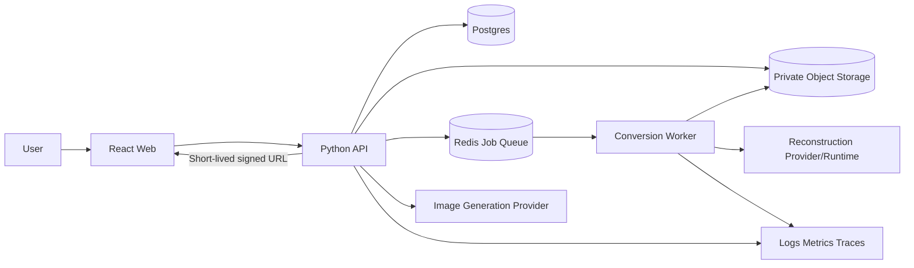

# System Architecture

> [!NOTE]
> This document describes the target production architecture. The current executable local MVP uses a loopback FastAPI service, a process-local worker, and a private local artifact store; see [Implementation Status](../implementation-status.md).

## 1. Architecture goals

3Craft combines AI inference, geometry processing, Minecraft export, and an interactive Web viewer. Putting every area in one process makes timeouts, dependency conflicts, GPU scaling, and failure recovery difficult. Boundaries follow these principles:

1. Separate the HTTP request lifetime from long-running job lifetimes.
2. Treat source and intermediate artifacts as immutable.
3. Give every stage explicit inputs, outputs, versions, budgets, and gates.
4. Put providers and file formats behind adapters.
5. Treat worker restarts and duplicate queue delivery as normal conditions.
6. Separate internal geometry/voxel contracts from external Minecraft formats.
7. The browser handles input, state, and rendering—not secrets, AI execution, or NBT processing.
8. Do not publish a result after a required gate fails.

## 2. Context



If image generation is expensive or slow, it also moves to the same job queue. Even if an MVP API invokes an adapter directly, the target external contract remains an asynchronous job.

## 3. Recommended technology composition

### 3.1 Web

- React + TypeScript + Vite
- Mount an imperative Three.js viewer inside the React lifecycle.
- Use a typed API client and generated contract types.
- Prefer SSE with polling fallback.
- Decode voxels and prepare instance arrays in a Web Worker.

React Three Fiber is optional. A vanilla Three.js wrapper is the default because it preserves the explicit scene/renderer/resource lifecycle from gpthreejs and gives precise control over a high-block-count viewer. R3F may be selected after a team-skill and spike review, but resource ownership and instancing requirements remain unchanged.

### 3.2 API

- Python ASGI framework
- OpenAPI documentation and request validation
- Postgres metadata database
- S3-compatible object storage
- Redis-backed queue
- Authentication adapter: anonymous alpha sessions, extensible to a production identity provider

Milestone 0 must confirm and pin exact framework/queue versions after maintenance and license review.

### 3.3 Worker

- Python process/container
- Runner abstraction that can separate CPU and GPU stages
- Model/provider adapters
- Stage leases, heartbeats, and manifests
- Strict temporary directories and resource budgets
- Geometry, voxel, and export core

### 3.4 Contract package

Use JSON Schema/OpenAPI as the source of truth and generate or synchronize TypeScript and Python types. If both type sets are maintained manually, CI cross-validates shared schema fixtures.

## 4. Target repository boundaries

```text
apps/web
  src/features/source
  src/features/conversion
  src/features/jobs
  src/features/viewer
  src/lib/api
  src/lib/runtime

services/api
  app/routes
  app/domain
  app/persistence
  app/storage
  app/queue
  app/providers

services/worker
  worker/consumer
  worker/stages
  worker/providers

threecraft
  contracts
  reference
  sense
  reconstruction
  mesh
  voxel
  palette
  export
  quality
  runtime

packages/contracts
packages/viewer
packages/minecraft-data
```

Do not implement algorithms in API routes. Use domain commands and artifact interfaces so worker stages do not depend directly on HTTP or database entities.

## 5. Core component responsibilities

### 5.1 Asset Service

- Create upload sessions.
- Validate owner and quota.
- Issue storage keys.
- Perform server-side signature/decode validation.
- Create canonical sources and provenance.
- Manage retention and deletion state.

### 5.2 Image Generation Service

- Accept provider-neutral requests.
- Apply prompt profiles.
- Enforce generation budgets and moderation/policy.
- Copy provider output into private storage and validate it.
- Register it in the ReferenceSet as generated evidence.
- Never run when valid supplied image bytes are present.

### 5.3 Job Service

- Validate conversion requests.
- Manage idempotency and request hashes.
- Manage state machines and events.
- Publish through the queue/outbox.
- Cancel, retry, and clone.
- Enforce artifact publication conditions.

### 5.4 Pipeline Orchestrator

```text
intake
→ normalize
→ sense
→ sufficiency
→ reconstruct
→ mesh_process
→ voxelize
→ map_blocks
→ render_review
→ export
→ validate_delivery
```

Each stage receives `StageContext` and input artifact IDs and returns `StageResult`. A stage function does not mutate database state arbitrarily; the orchestrator owns transitions.

### 5.5 Provider Adapters

- `ImageGenerationProvider`
- `SegmentationProvider`
- `ReconstructionProvider`
- `ObjectStorage`
- `JobQueue`
- `SchematicCodec` or export validator

Adapters normalize only necessary vendor fields instead of storing vendor raw objects in internal manifests. If a raw response is needed for debugging, retain it briefly as an access-restricted encrypted diagnostic artifact.

### 5.6 Viewer Package

- Canvas and renderer lifecycle
- Voxel-preview decoding
- Instanced geometry grouped by palette
- Camera fit, controls, and layer clipping
- Selection and statistics
- Canonical capture
- Disposal/leak-probe hooks

## 6. End-to-end sequence

```mermaid
sequenceDiagram
  actor User
  participant Web
  participant API
  participant Store
  participant Queue
  participant Worker
  participant Provider

  User->>Web: Select image and/or enter prompt
  Web->>API: Request source resolution
  API->>API: Prefer supplied image; generate only if absent
  API-->>Web: Asset/job ID
  Web->>Store: Signed upload (production target)
  Web->>API: Upload complete
  API->>Store: Validate file and create canonical asset
  User->>Web: Submit conversion settings
  Web->>API: POST conversion + idempotency key
  API->>Queue: Publish job ID
  API-->>Web: 202 Accepted
  Worker->>Queue: Acquire lease
  Worker->>Store: Read source/manifest
  Worker->>Worker: Sense + sufficiency
  Worker->>Provider: Reconstruction
  Worker->>Worker: Mesh → voxel → palette → export
  Worker->>Store: Write candidate artifacts temporarily
  Worker->>Worker: Run delivery gates
  Worker->>Store: Publish validated artifacts
  Web->>API: SSE/poll status
  API-->>Web: Completed + artifact metadata
  Web->>API: Request authorized download
  API-->>Web: Short-lived signed URL
```

## 7. Job state machine

```text
queued
→ preprocessing
→ assessing
→ reconstructing
→ mesh_processing
→ voxelizing
→ mapping_blocks
→ reviewing
→ exporting
→ validating
→ completed
```

Auxiliary states:

- `cancel_requested`
- `cancelled`
- `retry_wait`
- `failed`

Invariants:

- A terminal state never transitions directly to another state.
- Progress never decreases within an attempt.
- `completed` has the required artifact set and delivery report.
- `failed` has a public error and operator reference.
- Database version/CAS resolves cancel-versus-complete races with one winner.
- A retry may reuse a previous stage artifact only by checksum.

## 8. Artifact architecture

### 8.1 Layers

1. Source: original upload/provider output
2. Canonical: image with normalized decode, orientation, and color space
3. Evidence: ReferenceSet, mask, edges, depth, palette, diagnostics
4. Reconstruction: raw/repaired mesh and texture
5. Voxel: occupancy, block indices, preview payload
6. Review: canonical renders, metrics, gate report
7. Delivery: schematic, BOM, user manifest

### 8.2 Publication pattern

- The worker writes to a job-scoped temporary key.
- It validates byte hashes and schemas.
- It records the artifact row as `candidate`.
- It changes the artifact to `published` only after delivery gates pass.
- The client receives only published artifacts.
- Failed/cancelled candidates are subject to retention cleanup.

## 9. Pipeline route selection

| Condition | Default route | Reason |
|---|---|---|
| Flat logo/face/front-relief request | relief | Matches intent without inferring a back |
| Single object, general 3D | single-image mesh | Production MVP primary target |
| Multiple consistent views supplied | multi-view mesh | Later/high-quality route |
| Empty mask/severe clipping | reject/ask | Forbid quiet low-quality generation |
| GPU/provider unavailable | relief or ask | Forbid fake meshes |

Route policy is versioned configuration. User settings alone cannot bypass a hard gate.

## 10. Deployment profiles

### 10.1 Local

- Vite development server
- API process
- Local Postgres/Redis/S3-compatible containers in the production-development target
- Fixture reconstruction adapter
- CPU relief/voxel worker
- Optional local GPU adapter

The current executable MVP intentionally uses a local filesystem and process-local job manager instead of these production dependencies.

### 10.2 CI

- Fake/fixture provider
- Ephemeral database/queue/storage
- Deterministic mesh fixture
- Browser smoke test
- Independent schematic parser
- GPU model tests on a separate scheduled runner

### 10.3 Staging

- Production-equivalent network, identity, and storage topology
- Small quotas
- Sample fixtures and non-sensitive data
- Staging-scoped real provider keys
- Release-candidate and model/palette-version validation

### 10.4 Production

- Stateless horizontal scaling for Web/API
- Separately scalable CPU and GPU worker queues
- Private subnets and least privilege
- Queue dead-letter handling and oldest-age alerts
- Pinned model image/weight checksums
- Object lifecycle policies and backups

## 11. Scaling and backpressure

Observe:

- queue depth and oldest job age;
- stage p50/p95;
- provider rate limits;
- GPU utilization, VRAM, and OOM;
- voxel time by resolution/fill mode;
- artifact size;
- retry/abort/override rates.

Scaling policy:

- Scale API load and GPU workers independently.
- Limit concurrent jobs per user.
- Add admission control for 64/128-axis output.
- Use provider circuit breakers.
- Prevent starvation if queue priorities are introduced.
- Decide on model warm pools only after measuring idle cost and load time.

## 12. Failure boundaries

- A leased worker job can continue if the API dies.
- After a worker dies, retry from an idempotent stage after lease expiry.
- Never transition to completed after a storage-write failure.
- Keep image upload and relief capabilities available when a generation/reconstruction provider fails.
- After export validation fails, reconstruction/voxel artifacts may remain for diagnostics, but no user schematic is published.
- Viewer failure cannot damage server artifacts; authorized downloads remain a separate path.

## 13. Architecture validation spike

Before implementation, prove this vertical slice:

```text
fixture PNG
→ canonical asset + ReferenceSet
→ relief mesh
→ 32-axis voxel
→ safe palette
→ `.schem`
→ independent round-trip
→ browser instanced preview
```

The target slice includes database/queue adapters but does not require a real AI model. A reconstruction adapter can then enter through the same contract. The current local MVP proves the deterministic source-to-schematic subset and records the remaining target components in the implementation status.
