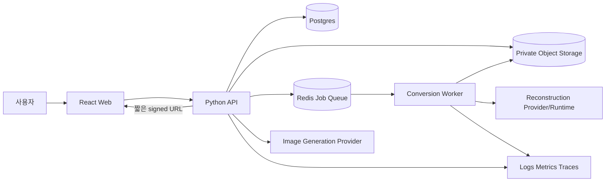
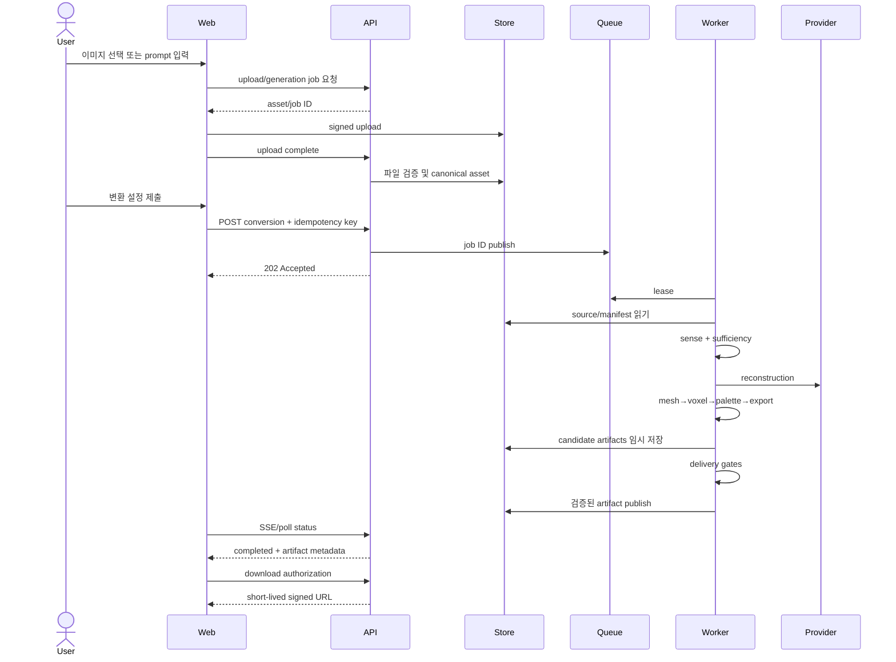

# 시스템 아키텍처

## 1. 아키텍처 목표

3Craft는 AI inference, geometry 처리, Minecraft export와 interactive web viewer가 결합된 시스템이다. 각 영역을 한 process에 넣으면 timeout, dependency 충돌, GPU 확장과 실패 복구가 어려워진다. 다음 원칙으로 경계를 정한다.

1. HTTP request 수명과 장시간 job 수명을 분리한다.
2. source와 intermediate artifact를 immutable하게 다룬다.
3. stage는 명시적 입력·출력·version·budget·gate를 가진다.
4. provider와 파일 format은 adapter 뒤에 둔다.
5. worker 재시작과 중복 queue delivery를 정상 상황으로 취급한다.
6. 내부 geometry/voxel 계약과 외부 Minecraft format을 분리한다.
7. 브라우저는 입력·상태·렌더링을 담당하고 secret/AI/NBT 처리를 하지 않는다.
8. 필수 gate 실패 시 결과를 공개하지 않는다.

## 2. 컨텍스트



이미지 생성도 비용과 시간이 크면 동일 job queue로 이동한다. MVP 구현에서 API가 adapter를 호출하더라도 외부 계약은 비동기 job으로 유지한다.

## 3. 권장 기술 구성

### 3.1 Web

- React + TypeScript + Vite
- imperative Three.js viewer를 React lifecycle 안에 mount
- typed API client와 generated contract type
- SSE 우선, polling fallback
- Web Worker 기반 voxel decode/instance 준비

React Three Fiber는 필수가 아니다. gpthreejs의 명시적인 scene/renderer/resource lifecycle을 활용하고 block 수가 많은 viewer를 세밀하게 제어하기 위해 vanilla Three.js wrapper를 기본으로 한다. 팀 역량과 spike 결과에 따라 R3F를 선택할 수 있으나 resource ownership과 instancing 요구는 동일하다.

### 3.2 API

- Python ASGI framework
- OpenAPI 문서와 request validation
- Postgres metadata DB
- S3-compatible object storage
- Redis-backed queue
- 인증은 adapter: alpha anonymous session, production identity provider 확장

실제 framework와 queue package는 Milestone 0에서 정확한 버전, 유지보수성과 라이선스를 확인해 pin한다.

### 3.3 Worker

- Python process/container
- CPU stage와 GPU stage를 분리 가능한 runner abstraction
- model provider adapter
- stage lease/heartbeat/manifest
- strict temp directory와 resource budget
- geometry, voxel, export core

### 3.4 Contract package

JSON Schema/OpenAPI를 source of truth로 두고 TypeScript와 Python type을 생성하거나 동기화한다. 수동으로 양쪽 타입을 유지하는 경우 CI에서 schema fixture를 상호 검증한다.

## 4. 목표 저장소 경계

```text
apps/web
  src/features/source
  src/features/conversion
  src/features/jobs
  src/features/viewer
  src/lib/api
  src/lib/runtime

services/api
  app/routes
  app/domain
  app/persistence
  app/storage
  app/queue
  app/providers

services/worker
  worker/consumer
  worker/stages
  worker/providers

threecraft
  contracts
  reference
  sense
  reconstruction
  mesh
  voxel
  palette
  export
  quality
  runtime

packages/contracts
packages/viewer
packages/minecraft-data
```

API route에서 algorithm을 구현하지 않는다. worker stage가 HTTP 또는 DB entity에 직접 의존하지 않게 domain command와 artifact interface를 사용한다.

## 5. 핵심 컴포넌트 책임

### 5.1 Asset Service

- upload session 생성
- owner와 quota 검증
- storage key 발급
- server-side signature/decode 검증
- canonical source와 provenance 생성
- retention과 삭제 상태 관리

### 5.2 Image Generation Service

- provider-neutral request
- prompt profile 적용
- generation budget과 moderation/policy 처리
- provider output을 private storage로 복사 후 검증
- generated evidence로 ReferenceSet 등록

### 5.3 Job Service

- conversion request validation
- idempotency와 request hash
- 상태 머신과 event
- queue publish/outbox
- cancel/retry/clone
- artifact 공개 조건

### 5.4 Pipeline Orchestrator

```text
intake
→ normalize
→ sense
→ sufficiency
→ reconstruct
→ mesh_process
→ voxelize
→ map_blocks
→ render_review
→ export
→ validate_delivery
```

각 stage는 `StageContext`와 input artifact ID를 받고 `StageResult`를 반환한다. DB status를 stage 함수 안에서 임의로 수정하지 않고 orchestrator가 transition을 책임진다.

### 5.5 Provider Adapters

- `ImageGenerationProvider`
- `SegmentationProvider`
- `ReconstructionProvider`
- `ObjectStorage`
- `JobQueue`
- `SchematicCodec` 또는 export validator

adapter는 vendor raw object를 내부 manifest에 저장하지 않고 필요한 field만 정규화한다. 원본 response가 debugging에 필요하면 접근 제한된 encrypted diagnostic artifact로 보관하고 retention을 짧게 한다.

### 5.6 Viewer Package

- canvas와 renderer lifecycle
- voxel preview decode
- palette별 instanced geometry
- camera fit, controls, layer clipping
- selection과 stats
- canonical capture
- dispose/leak probe hook

## 6. End-to-end sequence



## 7. Job 상태 머신

```text
queued
→ preprocessing
→ assessing
→ reconstructing
→ mesh_processing
→ voxelizing
→ mapping_blocks
→ reviewing
→ exporting
→ validating
→ completed
```

보조 상태:

- `cancel_requested`
- `cancelled`
- `retry_wait`
- `failed`

불변조건:

- terminal state에서 다른 상태로 직접 이동하지 않는다.
- progress는 attempt 안에서 감소하지 않는다.
- `completed`에는 필수 artifact set과 delivery report가 있다.
- `failed`에는 public error와 operator reference가 있다.
- cancel과 complete 경쟁은 DB version/CAS로 하나만 승리한다.
- retry attempt는 이전 stage artifact를 checksum으로 재사용할 수 있다.

## 8. Artifact architecture

### 8.1 계층

1. Source: 원본 upload/provider output
2. Canonical: decode, orientation, color space가 정규화된 이미지
3. Evidence: ReferenceSet, mask, edges, depth, palette, diagnostics
4. Reconstruction: raw/repaired mesh와 texture
5. Voxel: occupancy, block indices, preview payload
6. Review: canonical renders, metrics, gate report
7. Delivery: schematic, BOM, user manifest

### 8.2 Publish pattern

- worker는 job-scoped temporary key에 쓴다.
- byte hash와 schema validation을 수행한다.
- DB에 artifact row를 `candidate`로 기록한다.
- delivery gate 통과 후 `published`로 전환한다.
- client에는 published artifact만 반환한다.
- 실패/취소 candidate는 retention cleanup 대상이다.

## 9. Pipeline route 선택

| 조건 | 기본 route | 이유 |
|---|---|---|
| 평면 로고/얼굴/정면 relief 요청 | relief | 뒷면 추정 없이 의도에 맞음 |
| 단일 물체, 일반 3D | single-image mesh | MVP primary |
| 복수 일관 view 제공 | multi-view mesh | 후속/고품질 |
| 빈 mask/심각한 clipping | reject/ask | 조용한 저품질 생성 금지 |
| GPU/provider 사용 불가 | relief 또는 ask | fake mesh 금지 |

route policy는 versioned configuration이며 user setting만으로 hard gate를 우회하지 않는다.

## 10. 배포 profile

### 10.1 Local

- Vite dev server
- API process
- local Postgres/Redis/S3-compatible containers
- fixture reconstruction adapter
- CPU relief/voxel worker
- 선택적으로 local GPU adapter

### 10.2 CI

- fake/fixture provider
- ephemeral DB/queue/storage
- deterministic mesh fixture
- browser smoke
- independent schematic parser
- GPU model test는 별도 scheduled runner

### 10.3 Staging

- production과 같은 network/identity/storage topology
- 작은 quota
- sample fixture와 non-sensitive data
- 실제 provider key는 staging scope
- release candidate와 model/palette version 검증

### 10.4 Production

- stateless web/API horizontal scaling
- CPU worker와 GPU worker queue 분리 가능
- private subnet/least privilege
- queue dead-letter와 oldest-age alert
- model image/weight checksum pin
- object lifecycle policy와 backup

## 11. 확장과 backpressure

관찰 지표:

- queue depth와 oldest job age
- stage p50/p95
- provider rate limit
- GPU utilization/VRAM/OOM
- resolution/fill mode별 voxel 시간
- artifact size
- retry/abort/override rate

확장 정책:

- API 부하와 GPU worker를 독립 scale
- user concurrent job 제한
- 64/128축 admission control
- provider circuit breaker
- queue priority를 도입한다면 starvation 방지
- model warm pool은 idle 비용과 load time을 측정한 후 결정

## 12. 실패 경계

- API가 죽어도 leased worker job은 계속할 수 있다.
- worker가 죽으면 lease expiry 후 idempotent stage부터 재시도한다.
- storage write 실패 시 completed로 전환하지 않는다.
- provider 실패가 image upload/relief 기능 전체를 막지 않게 capability를 분리한다.
- export validation 실패 시 reconstruction/voxel artifact는 진단용으로 남길 수 있지만 사용자 schematic은 공개하지 않는다.
- viewer 실패는 server artifact를 손상시키지 않으며 다운로드는 별도 권한 경로로 가능하다.

## 13. 아키텍처 검증 spike

구현 전 다음 vertical slice를 통과한다.

```text
fixture PNG
→ canonical asset + ReferenceSet
→ relief mesh
→ 32축 voxel
→ safe palette
→ `.schem`
→ 독립 round-trip
→ browser instanced preview
```

이 slice에는 DB/queue adapter를 포함하되 실제 AI model은 필요하지 않다. 이후 reconstruction adapter를 같은 계약에 삽입한다.
